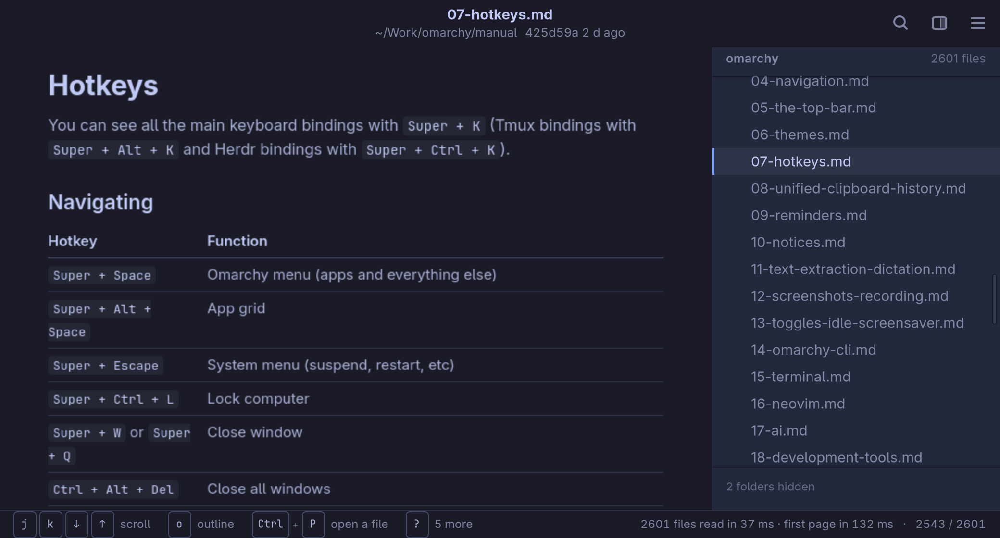
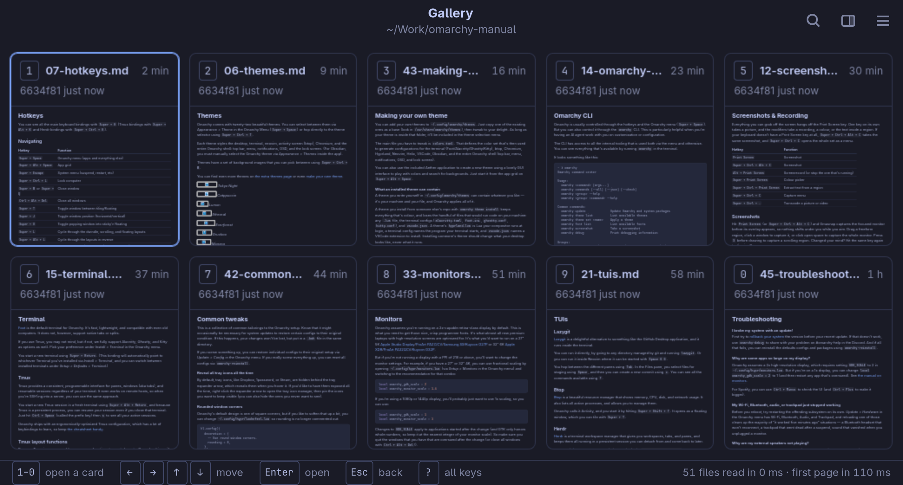

# omamv

A folder of Markdown, read like a book. A read-only, keyboard-first viewer for
[Omarchy](https://omarchy.org): open a folder and every `.md` and `.txt` file
in it is a few letters away, drawn in the active Omarchy theme.



```bash
omamv .            # this folder
omamv docs/        # that folder
omamv README.md    # its folder, with the file shown
omamv              # recent folders
```

The command hands over to the window and gives the prompt back (`-w` keeps
it). One instance serves every window; a folder already open comes forward.

## What it does

- **Markdown as GitHub draws it**: tables, task lists, alerts, footnotes,
  highlighted code, and Mermaid and PlantUML diagrams in the theme's colours.
  `.txt` as it is.
- **Obsidian vaults**: `[[wikilinks]]` are links, found the way Obsidian finds
  them; YAML front matter is a small block of facts.
- **HTML reports** (off until turned on in Settings): as their author made
  them, without their scripts.
- **The folder beside the page**: only folders with something to read, and
  what `.gitignore` leaves out left out.
- **Follows the disk**: a saved file is drawn again where you were reading; a
  new one is named in the status bar.
- **The newest first**: `Ctrl+P` lists every file with its age; `Ctrl+G` shows
  the ten newest as rendered cards, `1`–`0` to open one.
- **Remembers**: a folder opens on the file you read last there, at the same
  heading; back and forward step through what you read.
- **Its place in git**: the header says if the file is modified, staged or
  new, and its last commit.



## Careful by design

omamv opens folders it did not write, so what it does to them fits in a
sentence: it reads them.

- It never writes into a folder it shows. Its settings and memory live in
  `~/.config/omamv` and `~/.local/state/omamv`.
- No script in a document or report runs, and nothing a page does can start a
  program or open a browser. Only a link you click is followed.
- Nothing loads from the network but pictures a document links to, and that
  is a setting.
- Git is read with libgit2; no git command runs. PlantUML runs in its sandbox.
- `e` hands the file to your editor (Omarchy's, or the one you set); that is
  the only program omamv starts, and only on that key.

## Keys

`?` in the window lists them all; the status bar shows the ones that matter
where you are, and holding `Ctrl` shows what it does.

| Keys | |
| --- | --- |
| `j` `k` · `d` `u` · `Space` · `g g` `G` | scroll |
| `Ctrl+P` | open a file, the newest first |
| `Ctrl+G` | the gallery of the ten newest, `1`–`0` to open |
| `]` `[` | next / previous file |
| `H` `L` · `Alt+←` `Alt+→` · mouse thumb buttons | back / forward, each at its place |
| `o` | outline: go to a heading |
| `/` or `Ctrl+F` · `n` `N` | find |
| `Ctrl+B` · `<` `>` | folder tree: focus or hide · narrower / wider |
| `e` · `y` | open in your editor · copy the file's path |
| `Ctrl+Shift+S` | the whole page as one tall picture, saved and copied |
| `Ctrl+O` · `Ctrl+Shift+O` | open a folder · recent folders |
| `Ctrl+,` | settings |

## Install

Arch / Omarchy:

```bash
sudo pacman -S --needed rust webkitgtk-6.0 libadwaita libgit2
sudo pacman -S --needed plantuml   # optional: draws PlantUML diagrams
scripts/install.sh
```

`install.sh` builds a release, links it into `~/.local/bin` (where the
Hyprland session looks) and installs the desktop entry and icon.

## Development

```bash
cargo test           # unit tests
scripts/check.sh     # the whole app offscreen on GTK's Broadway display, then smoke.sh
scripts/smoke.sh     # the real binary, started as a person would
```

`check.sh` drives a debug build through every key path in a copy of
`tests/fixture`: it edits and removes files, switches the theme, and writes a
report with pictures to `target/check/`. It never touches your desktop. CI
runs the same in an Arch container. `OMAMV_DEBUG=1 omamv -w .` prints each
step of opening a folder and a page.

## License

MIT, see [LICENSE](LICENSE). Mermaid 11.12.0 is bundled in `assets/` (MIT,
[assets/MERMAID-LICENSE](assets/MERMAID-LICENSE)).
