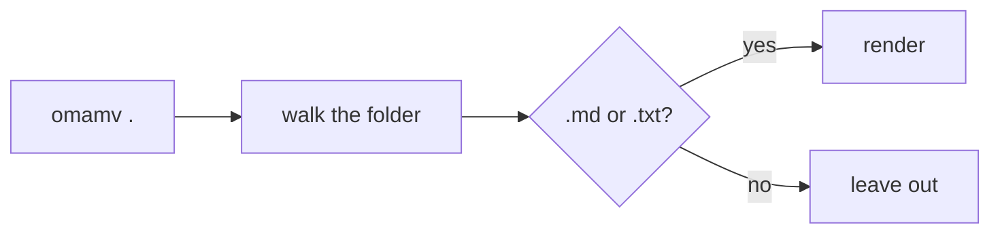
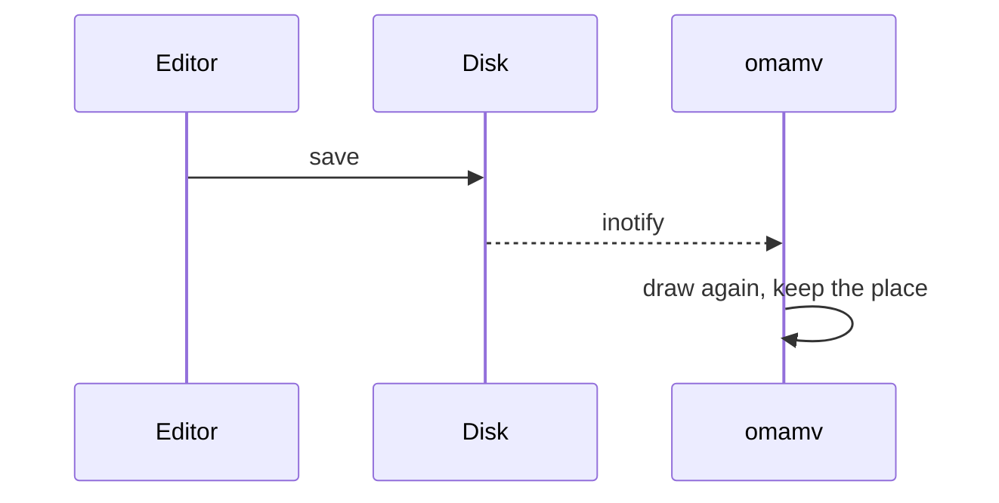
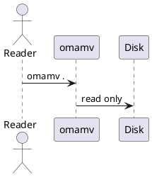

# omamv fixture

A paragraph with **bold**, *italic*, `inline code`, ~~strike~~, a [link to other](docs/other.md#second) and [a web link](https://example.com). Read the [architecture](docs/architecture.md) next.

> [!NOTE]
> omamv never writes. Editing is left to the editor in the window beside it.


<script>window.__pwned = 1</script>

<details><summary>Raw HTML, kept</summary>Hidden text.</details>

## Open a folder

| Command | Opens |
| :------ | ----: |
| `omamv .` | the current folder |
| `omamv docs/` | that folder |
| `omamv README.md` | its folder, with the file shown |

### Roadmap

- [x] Mermaid and PlantUML drawn in the theme's colours
- [x] Follows changes on disk and keeps your place
- [ ] A filter to show every folder

## Install

```bash
# needs webkitgtk-6.0
git clone https://github.com/montonen/omamv.git
cd omamv && scripts/install.sh
```

```rust
fn main() {
    let answer: u32 = 42; // a comment
    println!("hello {answer}");
}
```

## How a page is drawn





```mermaid
this is not a diagram
```

## PlantUML



## Keys

Scroll with <kbd>j</kbd> and <kbd>k</kbd>, open any file with <kbd>Ctrl</kbd>+<kbd>P</kbd>, press <kbd>?</kbd> for the rest.

## Section 1

Paragraph 1 about reading a folder of notes, one key away. The text runs on so the page is long enough to scroll through with j and k, and the place can be kept when the file is saved.

## Section 2

Paragraph 2 about reading a folder of notes, one key away. The text runs on so the page is long enough to scroll through with j and k, and the place can be kept when the file is saved.

## Section 3

Paragraph 3 about reading a folder of notes, one key away. The text runs on so the page is long enough to scroll through with j and k, and the place can be kept when the file is saved.

## Section 4

Paragraph 4 about reading a folder of notes, one key away. The text runs on so the page is long enough to scroll through with j and k, and the place can be kept when the file is saved.

## Section 5

Paragraph 5 about reading a folder of notes, one key away. The text runs on so the page is long enough to scroll through with j and k, and the place can be kept when the file is saved.

## Section 6

Paragraph 6 about reading a folder of notes, one key away. The text runs on so the page is long enough to scroll through with j and k, and the place can be kept when the file is saved.

## Section 7

Paragraph 7 about reading a folder of notes, one key away. The text runs on so the page is long enough to scroll through with j and k, and the place can be kept when the file is saved.

## Section 8

Paragraph 8 about reading a folder of notes, one key away. The text runs on so the page is long enough to scroll through with j and k, and the place can be kept when the file is saved.

## Section 9

Paragraph 9 about reading a folder of notes, one key away. The text runs on so the page is long enough to scroll through with j and k, and the place can be kept when the file is saved.

## Section 10

Paragraph 10 about reading a folder of notes, one key away. The text runs on so the page is long enough to scroll through with j and k, and the place can be kept when the file is saved.

## Section 11

Paragraph 11 about reading a folder of notes, one key away. The text runs on so the page is long enough to scroll through with j and k, and the place can be kept when the file is saved.

## Section 12

Paragraph 12 about reading a folder of notes, one key away. The text runs on so the page is long enough to scroll through with j and k, and the place can be kept when the file is saved.

## Section 13

Paragraph 13 about reading a folder of notes, one key away. The text runs on so the page is long enough to scroll through with j and k, and the place can be kept when the file is saved.

## Section 14

Paragraph 14 about reading a folder of notes, one key away. The text runs on so the page is long enough to scroll through with j and k, and the place can be kept when the file is saved.

## Section 15

Paragraph 15 about reading a folder of notes, one key away. The text runs on so the page is long enough to scroll through with j and k, and the place can be kept when the file is saved.

## Section 16

Paragraph 16 about reading a folder of notes, one key away. The text runs on so the page is long enough to scroll through with j and k, and the place can be kept when the file is saved.

## Section 17

Paragraph 17 about reading a folder of notes, one key away. The text runs on so the page is long enough to scroll through with j and k, and the place can be kept when the file is saved.

## Section 18

Paragraph 18 about reading a folder of notes, one key away. The text runs on so the page is long enough to scroll through with j and k, and the place can be kept when the file is saved.

## Section 19

Paragraph 19 about reading a folder of notes, one key away. The text runs on so the page is long enough to scroll through with j and k, and the place can be kept when the file is saved.

## Section 20

Paragraph 20 about reading a folder of notes, one key away. The text runs on so the page is long enough to scroll through with j and k, and the place can be kept when the file is saved.

## Section 21

Paragraph 21 about reading a folder of notes, one key away. The text runs on so the page is long enough to scroll through with j and k, and the place can be kept when the file is saved.

## Section 22

Paragraph 22 about reading a folder of notes, one key away. The text runs on so the page is long enough to scroll through with j and k, and the place can be kept when the file is saved.

## Section 23

Paragraph 23 about reading a folder of notes, one key away. The text runs on so the page is long enough to scroll through with j and k, and the place can be kept when the file is saved.

## Section 24

Paragraph 24 about reading a folder of notes, one key away. The text runs on so the page is long enough to scroll through with j and k, and the place can be kept when the file is saved.

## Section 25

Paragraph 25 about reading a folder of notes, one key away. The text runs on so the page is long enough to scroll through with j and k, and the place can be kept when the file is saved.

## Section 26

Paragraph 26 about reading a folder of notes, one key away. The text runs on so the page is long enough to scroll through with j and k, and the place can be kept when the file is saved.

## Section 27

Paragraph 27 about reading a folder of notes, one key away. The text runs on so the page is long enough to scroll through with j and k, and the place can be kept when the file is saved.

## Section 28

Paragraph 28 about reading a folder of notes, one key away. The text runs on so the page is long enough to scroll through with j and k, and the place can be kept when the file is saved.

## Section 29

Paragraph 29 about reading a folder of notes, one key away. The text runs on so the page is long enough to scroll through with j and k, and the place can be kept when the file is saved.

## Section 30

Paragraph 30 about reading a folder of notes, one key away. The text runs on so the page is long enough to scroll through with j and k, and the place can be kept when the file is saved.
